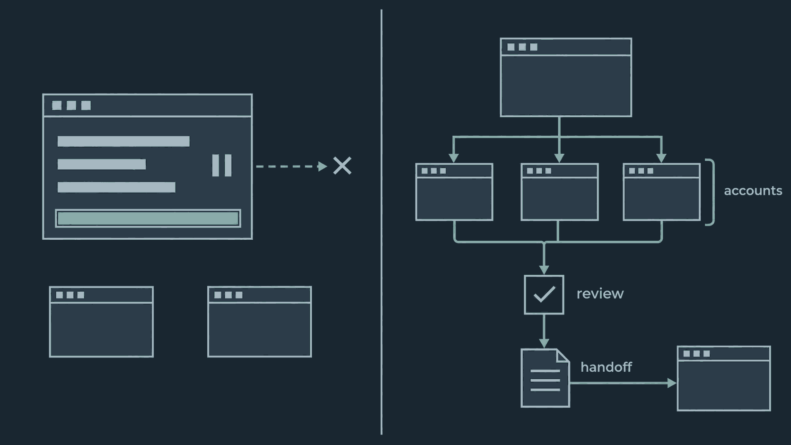

# ps-ai

Long work stalls when one AI session loses context or hits its usage limit. It has no independent reviewer, while your other subscriptions and accounts sit unused. Starting another session means explaining the work again.

ps-ai connects **Claude Code, Codex CLI and Copilot CLI** into a team. An **overseer** session plans and tracks work in your repository, dispatches tasks to **legion members** on other accounts and CLIs, reviews their reports, and records progress in a handoff file. The next session continues from that handoff. You drive the work by talking to your AI tool: answer its questions and approve its proposals.




## Install

```powershell
& ([scriptblock]::Create((irm https://raw.githubusercontent.com/BlackGad/ps-ai-marketplace/main/install.ps1)))
```

Run this in PowerShell to install ps-ai for your installed AI tools; it asks before installing missing prerequisites.

## First-time setup

Open your AI tool and work through these steps by saying:

1. **Set your preferences.** “Set up my agent preferences.” Answer the questions about how you want to work and receive updates. In Codex, open `/hooks` once per account and approve the ps-ai hooks.
2. **Add accounts and choose legion members.** “Add a Codex account called `<your name for it>` and make it a legion member.” You pick the name; it becomes the command that starts that account. For an account you already use: “Add my existing Claude Code account from `<account folder>` and make it a legion member.” If the tool for an account isn't installed yet, ps-ai can install it when you ask. You log in yourself for a new account; existing folders keep their settings and login. Approve installing ps-ai into each added account.
3. **Approve legion access.** Setup explains that legion members run without a sandbox, with your full user rights, so they can use your installed tools. Read the note and say “Yes, enable legion” if you accept.
4. **Set up your repository.** Open a session in the repository and say “Set up orchestration in this repository.”
5. **Start work.** Describe what you want done, then say “Continue” or “Next milestone.” The overseer plans, assigns tasks, and brings questions and results back to you.
6. **Come back later.** Open a new session in the same repository and say “Continue.” The overseer reads the handoff and picks up where the previous session stopped.

## What you can do

Open your AI tool and say:

- “Continue.” / “Next milestone.”
- “Add another legion member.”
- “Check limits for `<account name>`.”
- “Change my notification preferences.”
- “Add an Azure Foundry agent.”
- “What was learned elsewhere?”

## Update and uninstall

Say “Update ps-ai” or “Uninstall ps-ai.” Your tool guides you through approval; one update covers all accounts ps-ai knows. By hand, run the matching one-liner in PowerShell:

```powershell
& ([scriptblock]::Create((irm https://raw.githubusercontent.com/BlackGad/ps-ai-marketplace/main/install.ps1))) -Update
```

```powershell
& ([scriptblock]::Create((irm https://raw.githubusercontent.com/BlackGad/ps-ai-marketplace/main/install.ps1))) -Uninstall
```

## Security

Legion members have your full user rights. They are instructed to stay in their assigned repository, never push or install tools, and report missing tools. These are instructions, not enforced access limits. Use accounts you trust, or leave legion unused. Never share tokens or credentials with an agent.

[Details for maintainers and power users](docs/reference.md).

License: [MIT](LICENSE).
