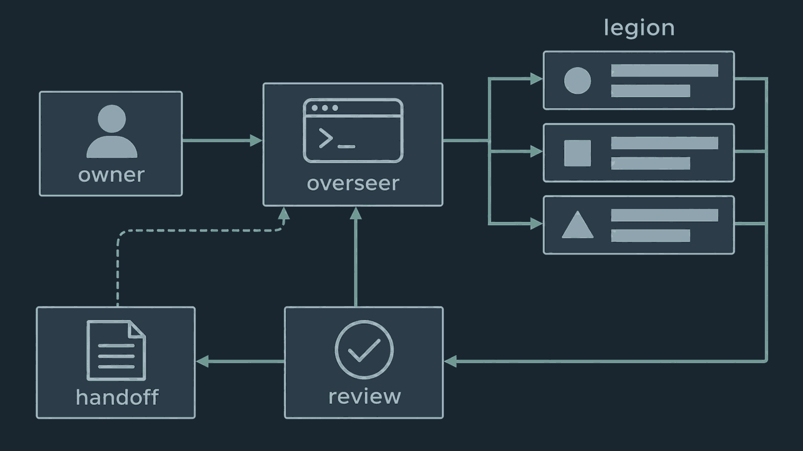

# ps-ai

[](https://github.com/BlackGad/ps-ai-marketplace/actions/workflows/tests.yml)
[](https://github.com/BlackGad/ps-ai-marketplace/actions/workflows/integration.yml)
[](https://github.com/BlackGad/ps-ai-marketplace/releases)

Long work stalls when one AI session loses context or hits its usage limit. It has no independent reviewer, while your other subscriptions and accounts sit unused. Starting another session means explaining the work again.

ps-ai connects **Claude Code, Codex CLI and Copilot CLI** into a team. An **overseer** session plans and tracks work in your repository, dispatches tasks to **legion members** on other accounts and CLIs, reviews their reports, and records progress in a handoff file. The next session continues from that handoff. You drive the work by talking to your AI tool: answer its questions and approve its proposals.




## Install

```powershell
& ([scriptblock]::Create((irm https://raw.githubusercontent.com/BlackGad/ps-ai-marketplace/main/install.ps1)))
```

Run this in PowerShell to install ps-ai for your installed AI tools; it asks once before installing, and again before installing missing prerequisites. Add `-Yes` to skip the questions.

## Why mix tools

Different tools and providers give independent reviews another perspective. The overseer spreads work across your available accounts and says which account it chose. Each CLI uses that account's own default model. Preferences you state later are saved in notes and take priority.

## First-time setup

1. **Install.** Run the install command above. In Codex, open `/hooks` once per account and approve the ps-ai hooks.
2. **Add accounts.** Open your AI tool and say “Add a Codex agent called `<name>`” or “Add my existing Claude account from `<account folder>`.” You can also say “summon a minion”. Setup asks only which accounts to add. One yes approves installing ps-ai into the selected accounts. You log in yourself for new accounts. Existing folders keep their settings and login.
3. **Start work.** Run `legion` in your repository; it sets up orchestration if needed and reopens the last conversation. Describe what you want done, then say “Continue.” Before the first legion task, the overseer asks once about running without a sandbox and saves your answer in notes. Future sessions continue from the handoff.

Add preferences later in your own words. Say “use Telegram” when you want a channel.

ps-ai keeps settings in `~/.legion/configuration/`, account folders in `~/.legion/agents/`, and launchers in `~/.legion/bin/` on your PATH. Repository orchestration files live in `.legion/`.

Repository setup offers [Private (default) or Shared](plugins/ps-ai/skills/ps-ai-repository/SKILL.md#choose-where-notes-live) storage for notes and history.

## What you can do

Open your AI tool and say:

- “Continue.” / “Next milestone.”
- “Add another legion member.”
- “Check limits for `<account name>`.”
- “Change my notification preferences.”
- “Add an Azure Foundry agent.”
- “What was learned elsewhere?”

## Update and uninstall

Say “Update ps-ai” or “Uninstall ps-ai,” or run `legion update` or `legion uninstall`. One update covers all accounts ps-ai knows. If `legion` is not available, run the matching one-liner in PowerShell:

```powershell
& ([scriptblock]::Create((irm https://raw.githubusercontent.com/BlackGad/ps-ai-marketplace/main/install.ps1))) -Update
```

```powershell
& ([scriptblock]::Create((irm https://raw.githubusercontent.com/BlackGad/ps-ai-marketplace/main/install.ps1))) -Uninstall
```

Uninstall keeps your `ps-ai-setup`, `ps-ai-status`, `ps-ai-overseer` and `legion` commands working through another ps-ai install if one is left. If none is left, it removes them.

> [!IMPORTANT]
> Uninstall then install is an upgrade: it keeps your settings, notes, account folders and account launchers. **Purge removes every ps-ai trace**, including settings, notes and legion-made logins. It lists everything and asks first.

Run `legion uninstall --purge`, or use this PowerShell one-liner:

```powershell
& ([scriptblock]::Create((irm https://raw.githubusercontent.com/BlackGad/ps-ai-marketplace/main/install.ps1))) -Uninstall -Purge
```

## Security

Legion members have your full user rights. They are instructed to stay in their assigned repository, never push or install tools, and report missing tools. These are instructions, not enforced access limits. Use accounts you trust, or leave legion unused. Never share tokens or credentials with an agent.

[Details for maintainers and power users](docs/reference.md).

License: [MIT](LICENSE).
